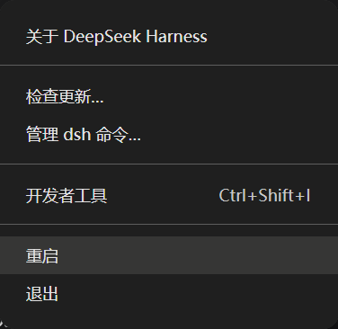
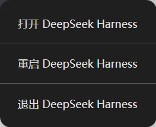
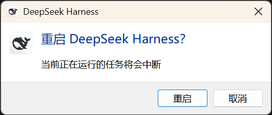

# dsh-restart

[](https://github.com/Cirl3cat/dsh-restart/actions/workflows/ci.yml)


给 **DeepSeek Harness 桌面端** 增加「重启」：

* **应用菜单**：`应用` → `开发者工具` 下面的横线之后、`退出` 之上，新增 **重启**（与 `检查更新…` / `管理 dsh 命令…` 的相邻关系一致）。
* **系统托盘**：右键菜单变成 `打开 DeepSeek Harness` / 分隔线 / **重启 DeepSeek Harness** / 分隔线 / `退出 DeepSeek Harness`。
* **等价于完全退出后冷启动**：走 Electron 的 `app.relaunch()` + 官方退出流程（Host 正常关闭、托盘图标正常移除），新进程完全冷启动；不是在旧进程里热重载。
* **语言跟随应用设置**：菜单文案直接取壳自带的 `restartApplication` / `aboutProduct` 词典，和「打开 / 退出」用的是同一套 locale。通用设置里切换语言后，标题菜单下一次弹出、托盘下一次刷新就变。
* 有任务在跑时先弹原生确认框（标题/按钮都是「重启」，说明沿用官方的「正在运行的任务将会中断」）；空闲时一次点击直接重启。

```
应用
├─ 关于 DeepSeek Harness
├─ ─────────────
├─ 检查更新…
├─ 管理 dsh 命令…
├─ ─────────────
├─ 开发者工具        Ctrl+Shift+I
├─ ─────────────
├─ 重启              ← 新增
└─ 退出
```

## 实际效果

| 应用菜单 | 系统托盘 |
| --- | --- |
|  |  |

有任务在运行时，点「重启」会先弹出与官方退出同源的确认框（标题和按钮都写「重启」，说明沿用官方文案）：



## 为什么需要改 `app.asar`

DSH 插件运行在 Host 子进程（Cordis），而「应用」菜单和系统托盘都属于 **Electron 主进程**；官方没有暴露菜单 / 托盘 / Electron 的扩展点。所以本插件在 Host 启动后，对桌面端 `resources/app.asar` 里的 `/lib/main.js` 打一个**最小、等长、可回滚**的补丁：

1. `applicationItems()` 里，在 `...hideCommands` 之后、`role: "quit"` 之前插入「重启」项；
2. `DesktopTray.relabel()` 的托盘模板里，在「打开」和「退出」之间插入「重启」，两侧都用官方同款分隔线；
3. `new DesktopTray({...})` 多传一个 `restart` 回调；
4. 在 `main()` 里注入 `restartApplication()`：先按官方的 `inspectQuit()` / `resolveDesktopQuitPrompt()` 判断要不要确认，再 `app.relaunch()` + `quitWithoutConfirmation()`。

补丁的几个硬约束：

* **等长改写**：`main.js` 的字节数完全不变（多出来的字节从 `//#region` / `//#endregion` 纯注释行里删掉，尾部空格补齐），asar 目录里其它文件的 `offset` 全部保持有效；
* **同步完整性摘要**：同时刷新 asar 目录里 `lib/main.js` 的 SHA-256（等长 hex），即使某个构建打开了 `EnableEmbeddedAsarIntegrityValidation` 也不会失配；
* **写前备份 + 语法预检**：先把原始 `main.js` 存到 `~/.dsh/dsh-restart/main.original.js`，生成的新内容先跑一次 `node --check`，再写盘；
* **幂等 + 失败即放弃**：已经是补丁状态只做只读检查；结构对不上（换了 DSH 版本或已被别的壳补丁改过）就一个字节都不写，只记日志。

## 安装

桌面端 profile 由 Electron 独占管理，`dsh plugin --profile desktop ...` 会被拒绝，请用插件管理器：

1. 设置 → 插件 → 从本地目录安装，指向本目录（含 `package.json` 的那一层）；
2. **完全退出并重新打开** DeepSeek Harness。第一次启动会打补丁，第二次启动菜单才会出现（主进程代码只在启动时读取）。

```bash
git clone https://github.com/Cirl3cat/dsh-restart.git
```

> 补丁在 Host 启动后约 2 秒执行；本次启动看到的仍是旧菜单，下一次启动生效。

## 桌面端升级之后

升级会把 `resources/app.asar` 整个换掉，补丁随之消失。插件**每次启动都会检查**：发现 `main.js` 是干净的官方结构就自动重打一次，所以升级后同样是「第一次启动重打、第二次启动显示菜单」；如果新版本结构变了，插件跳过并写日志，不会把客户端改坏。

## 手动命令

不需要装插件也能用，任何 Node.js ≥ 20：

```bash
node lib/patcher.mjs status            # 只读检查
node lib/patcher.mjs apply --dry-run   # 只验证能否安全打补丁
node lib/patcher.mjs apply             # 需要时打补丁（幂等）
node lib/patcher.mjs restore           # 写回安装前的原始 main.js
```

加 `--json` 输出机器可读结果，加 `--asar <path>` 指定别的 `app.asar`。

默认路径按以下顺序解析：`--asar` → `DSH_DESKTOP_APP_ASAR` → `DSH_NODE_EXECUTABLE` 同级的 `resources/app.asar` → 本进程可执行文件同级的 `resources/app.asar` → `%LOCALAPPDATA%\Programs\DeepSeek Harness\resources\app.asar` → `%ProgramFiles%\DeepSeek Harness\resources\app.asar`。

每次运行的状态在 `~/.dsh/dsh-restart/status.json`，日志在 `~/.dsh/dsh-restart/dsh-restart.log`。

## 卸载

```bash
node lib/patcher.mjs restore      # 先还原托盘与菜单
```

然后在插件管理器里移除本插件，最后退出并重开 DSH。若 `restore` 报 `size-mismatch`（桌面端已经升级过），直接重新安装官方桌面端即可。

## 安全边界与限制

* 只支持**打包的官方 Windows 桌面端**；`dsh web`、headless、开发模式没有系统托盘，插件会安全跳过。
* 只改写 `/lib/main.js` 中已知的四处结构；任何结构变化都会让补丁**失败而不是写坏文件**。
* 不改注册表、不加启动项、不联网。
* 需要重启一次才能看到菜单（主进程代码只在启动时读取）。
* 与其它直接改 `app.asar` 的工具可能冲突；`status` 显示 `unsupported` 时不要强行写入。

## 兼容性

| 项目 | 要求 |
| --- | --- |
| DSH | `>=0.2.2-rc.5 <0.3.0`（在 0.2.2-rc.5 上验证） |
| 平台 | 打包的 Windows 桌面端（Electron）；`dsh web` / headless 不受支持 |
| Node（CLI/测试用） | ≥ 20 |

补丁的硬门槛是**壳的 `lib/main.js` 结构**（四处锚点 + `restartApplication` 等词典键），不是版本号。DSH 升级后如果结构变了，patcher 返回 `unsupported` 并跳过写入——菜单不会出现，但客户端不会被改坏；此时更新 `lib/patch.js` 里的锚点即可。

## 开发

```bash
node --check index.js
node --test test/patch.test.mjs test/patcher.test.mjs   # 纯文本补丁 + 合成 asar 的 apply/restore
node lib/patcher.mjs status --json
```

`lib/patch.js` 是纯文本函数（无 IO），`lib/asar.js` 只做等长读写与摘要刷新，`lib/patcher.mjs` 是 CLI。

## English

`dsh-restart` adds a **Restart** entry to the DeepSeek Harness **desktop** app on Windows:

* **Application menu**: `应用` → **重启**, directly above **退出** (same adjacency as `检查更新…` / `管理 dsh 命令…`).
* **System tray**: `Open DeepSeek Harness` / separator / **Restart DeepSeek Harness** / separator / `Quit DeepSeek Harness`.
* **A real cold restart**: `app.relaunch()` plus the shell's own quit path (Host shutdown, tray icon disposal), not a renderer reload.
* **Follows the app language**: labels come from the shell's own `restartApplication` / `aboutProduct` dictionaries, the same locale used by Open/Quit.
* Running work is protected by the same inspection as Quit (`inspectQuit()` + `resolveDesktopQuitPrompt()`); the native confirmation is titled and labelled **Restart**.

Why an asar patch: DSH plugins run in the Host child process and Cordis exposes no Electron/menu/tray service, so the shell's `resources/app.asar` → `/lib/main.js` gets a byte-length-preserving patch (region-comment slack, trailing spaces, refreshed SHA-256 in the asar directory). The plugin re-applies it on every Host start, so desktop updates self-heal after one extra launch. `node lib/patcher.mjs restore` writes the saved original back.

## License

MIT
